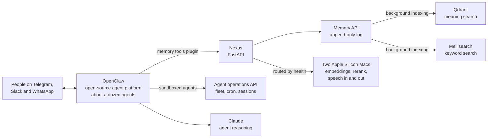

# Nexus

**Shared memory, local voice and model routing, and a safe operations API for a team of chat-based AI agents running on the open-source OpenClaw platform.**

---

## What it is

In early 2026 Ryan ran a self-hosted instance of [OpenClaw](https://github.com/openclaw/openclaw), an open-source platform for personal AI agents that people talk to through messaging apps. About a dozen agents, each with its own role, workspace and Telegram, Slack or WhatsApp channel, ran in one Docker deployment.

**OpenClaw itself is not Emergent's work.** Nexus is: a Python service built alongside it, over four days in February 2026, to give those agents things OpenClaw didn't provide out of the box. It adds a long-term memory every agent can write to and search, speech-to-text, text-to-speech and embeddings served by small models on local Apple Silicon Macs, and a narrow REST API that lets sandboxed agents check on and operate the system without shell access. Ryan also wrote a small set of plugins and fixes in his own fork of OpenClaw to connect the agents to Nexus (details below).

It was an experiment and is no longer running. It's here because the memory and routing design holds up, and because it shows how Emergent works with an open-source platform: extend it from the outside, keep the fork small.

## Highlights

- **A memory that survives crashes and finds the right thing.** Every memory is appended to a log on disk and flushed before the agent gets a reply, so nothing acknowledged is lost. A background loop indexes the log into two search engines, one by meaning (Qdrant) and one by keywords (Meilisearch). A search runs both, merges the rankings, re-ranks the top candidates with a dedicated model, and returns a compact "context pack" sized to fit in an agent's prompt.
- **Memory that stays tidy.** New memories are checked against existing ones and near-duplicates are rejected. Memories can supersede or deprecate older ones, get a simple importance score, and old low-value entries can be archived. Each memory records which agent wrote it, so an agent can search only its own memories or everyone's.
- **Local models, routed by health.** Embeddings, re-ranking, speech-to-text (Whisper) and text-to-speech (Kokoro) run on two Apple Silicon Macs using MLX. Nexus checks both machines every 15 seconds, sends each request to a healthy node that offers that capability, and caps concurrent requests so one busy agent can't exhaust a machine's memory. The endpoints are OpenAI-compatible, so OpenClaw and standard SDKs use them unchanged.
- **Agents can operate the system without a shell.** Sandboxed agents get a small token-protected REST API for fleet status, waking agents, scheduled jobs, session resets and service health checks. The only command execution it allows is a fixed list of harmless read-only commands.
- **Agents can verify their own work.** A validation endpoint runs the project's lint and test suites on request, one run at a time, and returns structured results.
- **Well tested for its size.** 280 automated tests (pytest) across the memory write and read paths, search, routing, authentication and the operations API.

## Architecture

People message the agents on Telegram, Slack or WhatsApp. OpenClaw routes each message to the agent bound to that channel, and the agent reasons with Claude. When an agent needs to remember or recall something, a plugin in Ryan's OpenClaw fork calls Nexus's memory API. Speech-to-text and text-to-speech requests go through Nexus's model router to the Macs. The memory stores and Nexus run as Docker containers and system services on one Linux workstation.

More detail on the memory pipeline is in [docs/architecture.md](docs/architecture.md).

## What Ryan added to OpenClaw

Ryan's fork of OpenClaw carries the project's full history of 8,816 commits. 28 of those are Ryan's, made between late January and early February 2026. They are small and targeted:

- Agent tools for writing, searching, deprecating and maintaining memories in Nexus, including search across all agents, packaged as an OpenClaw plugin.
- A plugin and a few authentication fixes that keep every agent signed in to Claude when credentials are refreshed.
- Fixes to message routing (honouring a channel's agent binding), scheduled-job delivery to the right agent and account, and session delivery for direct messages.
- A deep-merge option for configuration updates, and Docker deployment and health-check configuration.

Everything else in OpenClaw (the agent runtime, the channel integrations, the plugin system) is the work of the OpenClaw project and its contributors.

## Engineering notes

**Write once, index later.** The memory API never writes to the search engines directly. It appends to a log and returns; a reconciliation loop replays the log into both indexes from a saved position every 30 seconds. If an index is down or has to be rebuilt, it catches up from the log. Agents never wait on indexing, and the log is the single source of truth.

**Two searches beat one.** Meaning-based search finds "the deployment thing we discussed" but misses exact names and error codes; keyword search is the opposite. Nexus runs both, merges them with reciprocal rank fusion (which needs no score calibration between the two engines), then re-ranks the best 20 with a cross-encoder model. If the re-ranker is unavailable, search still answers with the merged ranking.

**Built for an agent's context window, not a human.** Search results come back as a context pack with a soft size target of 6 KB and a hard cap of 8 KB, so a memory lookup can never crowd out the conversation it is meant to help.

**Give agents a narrow door.** Agents inside OpenClaw's sandbox can't run commands on the host, which is the point. Rather than loosen the sandbox, Nexus offers a separate, token-protected API with a fixed set of operations, so an agent that keeps the system healthy can do its job with no shell at all.

## Tech stack

| Layer | Technology |
|---|---|
| Agent platform | [OpenClaw](https://github.com/openclaw/openclaw) (open source, Node.js/TypeScript), with a small set of Ryan's plugins and fixes |
| Agent model | Anthropic Claude |
| Nexus service | Python 3.12, FastAPI, Pydantic v2, httpx |
| Memory | Append-only JSONL log, Qdrant (vector search), Meilisearch (keyword search) |
| Local models | MLX on Apple Silicon: BGE embeddings and re-ranker, Whisper, Kokoro |
| Infrastructure | Docker Compose, systemd |
| Quality | pytest, ruff |

## By the numbers

These figures cover Nexus only, which is entirely Emergent's code. None of OpenClaw's code is counted.

| | |
|---|---|
| Nexus commits | 53 |
| Active development | 2026-02-05 to 2026-02-08 |
| Tracked files | 87 |
| Nexus lines of source | ~8,800 |
| Automated tests | 280 pytest tests in 11 test files |
| Ryan's commits in his OpenClaw fork | 28 (not counted above; the rest of the fork is OpenClaw's own history) |
| Languages | Python 100% |

## About this repo

Nexus's source code is private. This repository describes the project: what it does, how it is built, and the engineering choices behind it. No source code is published here. OpenClaw is an independent open-source project; see [github.com/openclaw/openclaw](https://github.com/openclaw/openclaw).

Built by [Emergent AI Agency](https://emergentaiagency.com) (Ryan Chappell, [@codeslayer44](https://github.com/codeslayer44)). For demos or consulting, get in touch through [emergentaiagency.com](https://emergentaiagency.com).
