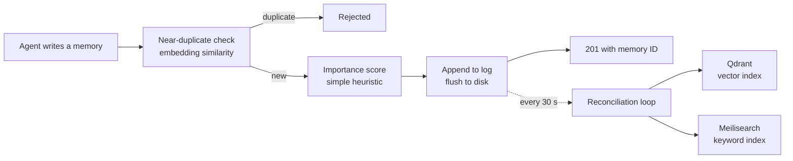
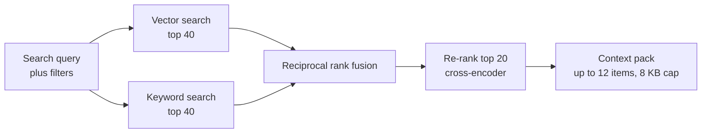

# Nexus: architecture notes

Nexus is one FastAPI application with four parts mounted behind a shared middleware stack. This page walks through each, with most of the space on the memory system.

## Request handling

Every request passes through the same layers before it reaches a route:

1. **Token authentication** on every route except a basic health check.
2. **Agent identity.** Memory routes require a known agent ID, so every memory is attributed to the agent that wrote it.
3. **Rate limiting** with separate sliding-window limits for reads and writes.

## Memory: write path

- **Near-duplicate check.** The new memory is embedded and compared with its closest existing neighbours; anything at or above 0.95 cosine similarity is refused.
- **Supersede and deprecate.** A memory can declare that it replaces an older one; the older one is marked deprecated in the same log and drops out of search.
- **Importance.** A deterministic heuristic (source, links, tags, title quality) gives every memory a score from 0 to 1. No model call, so writes stay fast and the score is explainable.
- **Durability.** The append is flushed to disk before the response is sent.
- **Indexing.** A background loop reads the log from a saved byte position, embeds and upserts each entry into Qdrant and indexes it in Meilisearch, then advances the position. A failed or rebuilt index catches up on its own.

## Memory: read path

- Both searches run in parallel and respect the same filters (tags, source agent, status, date range).
- Reciprocal rank fusion combines the two lists by rank position, so neither engine's raw scores need calibrating against the other.
- Re-ranking is best-effort: if the re-ranker is down, the fused order is returned and the response says so.
- The context pack aims for 6 KB and never exceeds 8 KB, so it fits comfortably in an agent's prompt.

## Memory maintenance

Separate endpoints, called by a low-cost maintenance agent, support archiving old low-importance entries (a dry run by default), a full duplicate scan that groups near-identical memories, and a list of stale candidates for review. The scans only report; the agent decides what to deprecate or retag, so cleanup decisions stay visible. Tags can be edited in place.

## Model router

- Two Apple Silicon Macs run MLX model servers: BGE embeddings and re-ranker, Whisper speech-to-text, Kokoro text-to-speech.
- A health checker polls both every 15 seconds and records which capabilities each node offers.
- Each request goes to a healthy node for that capability; speech work can use either machine.
- A concurrency guard caps parallel requests to the embedding node, which protects its memory when several agents search at once.
- Embedding results are cached in memory (LRU, one-hour expiry), so repeated queries skip the network entirely.
- Routes follow OpenAI's API shapes, so OpenClaw and standard SDKs talk to them unchanged.

## Agent operations API

A small companion service gives sandboxed agents a fixed set of REST operations: system and fleet status, waking agents, listing and triggering scheduled jobs, inspecting and resetting sessions, and checking the health of supporting services and the model nodes. Health checks across services run in parallel and tolerate individual failures, so one slow dependency doesn't hide the state of the rest.

## Validation runner

An endpoint that runs the project's lint and test suites ("fast" or "full") and returns per-step results. Only one run happens at a time; a second request gets a clear "busy" response instead of competing for the machine.
